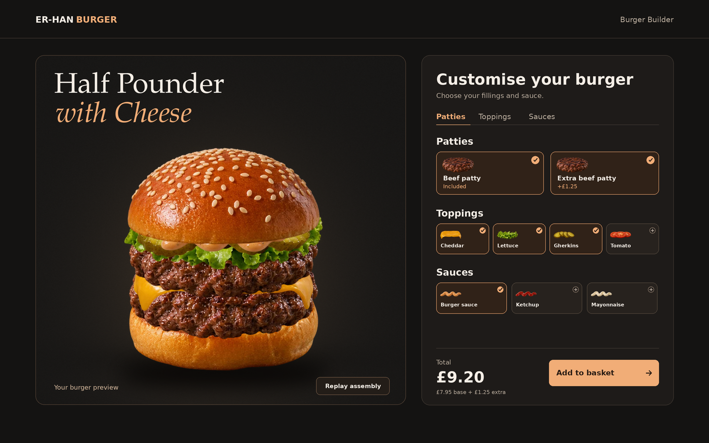
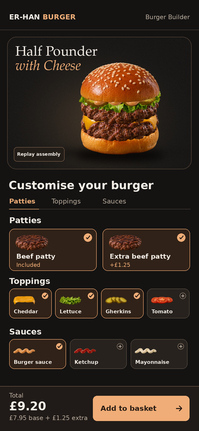
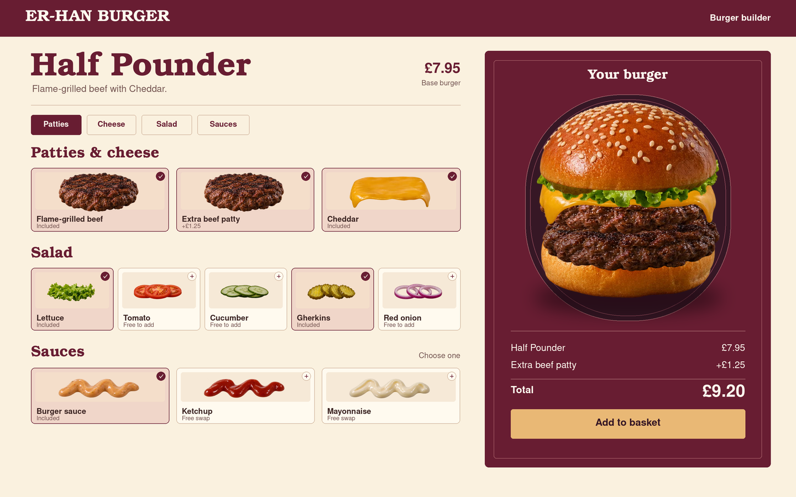
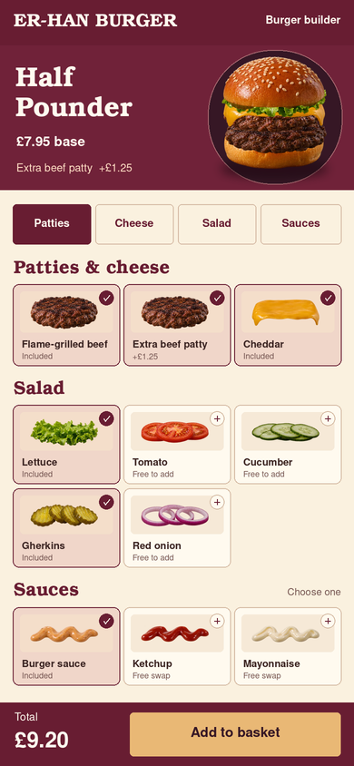
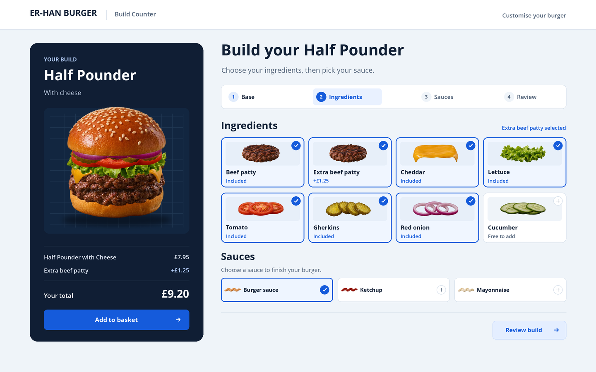
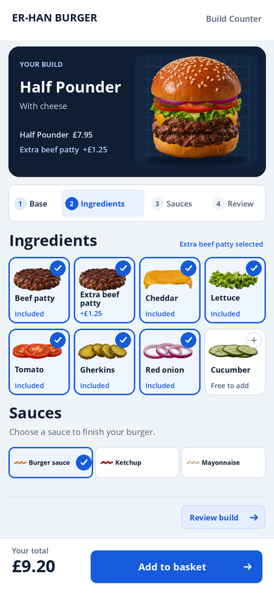

# Burger Builder interface concepts

Each concept shows a 1440 × 900 desktop view and a 390 × 844 mobile view. The artwork uses existing approved burger and ingredient images. These static mock-ups are for design approval.

| Concept | Desktop | Mobile |
| --- | --- | --- |
| Charcoal Studio | [Open desktop](01-desktop.png) | [Open mobile](01-mobile.png) |
| Menu Board | [Open desktop](02-desktop.png) | [Open mobile](02-mobile.png) |
| Build Counter | [Open desktop](03-desktop.png) | [Open mobile](03-mobile.png) |

## Charcoal Studio

The large charcoal and copper studio preview stays beside the ingredient panel on desktop. On mobile, the compact hero stays above the scrolling options, with the total and **Add to basket** pinned below.

 

## Menu Board

The cream and burgundy photo grid gives ingredients equal weight, with a persistent burger and order summary on the right. On mobile, the compact portrait and basket bar stay visible while the tiles scroll.

 

## Build Counter

A four-step flow guides customers from the base to review. The burger and basket summary stay on the left on desktop. On mobile, the compact preview and basket bar frame the active step.

 

## Pricing and approval

The mock-ups show an illustrative £7.95 base and a £1.25 extra beef patty, producing a £9.20 total. In the proposed interaction, the total updates as priced selections change and stays beside **Add to basket**. Confirm actual product prices and rules before implementation.

All customer-facing copy follows British English and all prices are shown in GBP (£). Implementation and website integration require approval.
